<!--
  Generated by "npm run cards" (src/render.ts). Do not edit by hand:
  change the text in src/content.ts and the look in design/tokens.json.
  The cards are refreshed every day by .github/workflows/update-cards.yml.
-->

<a href="README.md"><picture><source media="(prefers-color-scheme: dark)" srcset="./cards/dark/en/lang-en.svg"/></picture></a><a href="README.pt-BR.md"><picture><source media="(prefers-color-scheme: dark)" srcset="./cards/dark/en/lang-pt.svg"/></picture></a>

<a href="https://www.linkedin.com/in/eduardo-bergstron-986108143/"><picture><source media="(prefers-color-scheme: dark)" srcset="./cards/dark/en/hero.svg"/></picture></a>

<picture><source media="(prefers-color-scheme: dark)" srcset="./cards/dark/en/about.svg"/>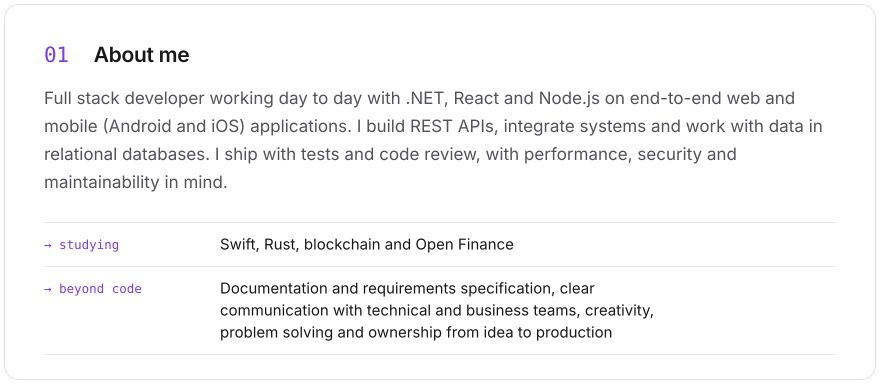</picture>

<a href="https://www.linkedin.com/in/eduardo-bergstron-986108143/"><picture><source media="(prefers-color-scheme: dark)" srcset="./cards/dark/en/experience.svg"/></picture></a>

<a href="https://www.linkedin.com/in/eduardo-bergstron-986108143/"><picture><source media="(prefers-color-scheme: dark)" srcset="./cards/dark/en/tile-work.svg"/>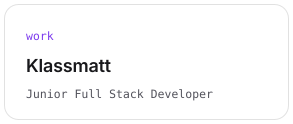</picture></a><a href="https://www.linkedin.com/feed/update/urn:li:activity:7526636901034987520/"><picture><source media="(prefers-color-scheme: dark)" srcset="./cards/dark/en/tile-shipped.svg"/>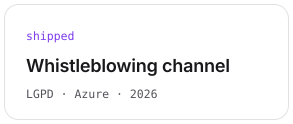</picture></a><a href="https://app.rocketseat.com.br/certificates/09da2ade-3667-41f8-933d-16cd36c43016"><picture><source media="(prefers-color-scheme: dark)" srcset="./cards/dark/en/tile-certified.svg"/>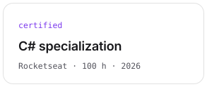</picture></a>

<a href="https://github.com/B3RG5TRON"><picture><source media="(prefers-color-scheme: dark)" srcset="./cards/dark/en/heatmap.svg"/></picture></a>

<picture><source media="(prefers-color-scheme: dark)" srcset="./cards/dark/en/title-projects.svg"/></picture>

<a href="https://github.com/B3RG5TRON/Food_Explorer_ReactJS"><picture><source media="(prefers-color-scheme: dark)" srcset="./cards/dark/en/repo-food-explorer-reactjs.svg"/></picture></a><a href="https://github.com/B3RG5TRON/Food_Explorer_NodeJS_API"><picture><source media="(prefers-color-scheme: dark)" srcset="./cards/dark/en/repo-food-explorer-nodejs-api.svg"/>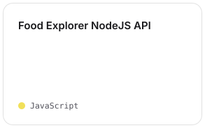</picture></a><a href="https://github.com/B3RG5TRON/Explorer_Stage_09_ReactJS_RocketNotes"><picture><source media="(prefers-color-scheme: dark)" srcset="./cards/dark/en/repo-explorer-stage-09-reactjs-rocketnotes.svg"/>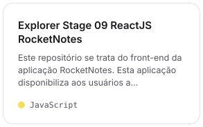</picture></a>

<a href="https://github.com/B3RG5TRON/Explorer_Stage_08_NodeJS_RocketNotes_API"><picture><source media="(prefers-color-scheme: dark)" srcset="./cards/dark/en/repo-explorer-stage-08-nodejs-rocketnotes-api.svg"/></picture></a><a href="https://github.com/B3RG5TRON/ShortsSumary"><picture><source media="(prefers-color-scheme: dark)" srcset="./cards/dark/en/repo-shortssumary.svg"/>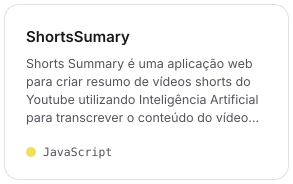</picture></a><a href="https://github.com/B3RG5TRON/Habit"><picture><source media="(prefers-color-scheme: dark)" srcset="./cards/dark/en/repo-habit.svg"/></picture></a>

<picture><source media="(prefers-color-scheme: dark)" srcset="./cards/dark/en/title-posts.svg"/></picture>

<a href="https://www.linkedin.com/feed/update/urn:li:activity:7526636901034987520/"><picture><source media="(prefers-color-scheme: dark)" srcset="./cards/dark/en/post-canal-denuncias.svg"/></picture></a><a href="https://www.linkedin.com/feed/update/urn:li:activity:7442300005383716864/"><picture><source media="(prefers-color-scheme: dark)" srcset="./cards/dark/en/post-csharp.svg"/>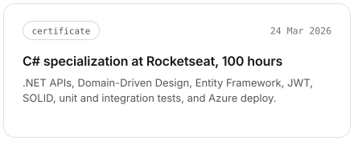</picture></a>

<a href="https://www.linkedin.com/feed/update/urn:li:activity:7300640469066117120/"><picture><source media="(prefers-color-scheme: dark)" srcset="./cards/dark/en/post-deploy.svg"/>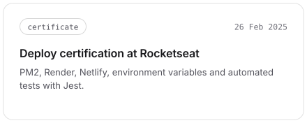</picture></a><a href="https://www.linkedin.com/feed/update/urn:li:activity:7270368952705327104/"><picture><source media="(prefers-color-scheme: dark)" srcset="./cards/dark/en/post-integration.svg"/>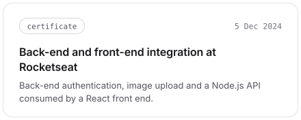</picture></a>

<a href="https://www.linkedin.com/feed/update/urn:li:activity:7526636901034987520/"><picture><source media="(prefers-color-scheme: dark)" srcset="./cards/dark/en/screen-start.svg"/>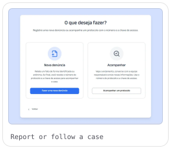</picture></a><a href="https://www.linkedin.com/feed/update/urn:li:activity:7526636901034987520/"><picture><source media="(prefers-color-scheme: dark)" srcset="./cards/dark/en/screen-anonymous.svg"/>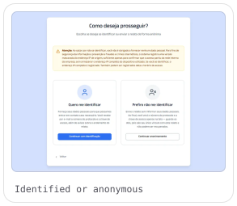</picture></a><a href="https://www.linkedin.com/feed/update/urn:li:activity:7526636901034987520/"><picture><source media="(prefers-color-scheme: dark)" srcset="./cards/dark/en/screen-privacy.svg"/>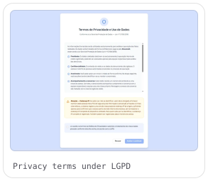</picture></a>

<picture><source media="(prefers-color-scheme: dark)" srcset="./cards/dark/en/languages.svg"/></picture>

<a href="mailto:bergstron.dev@icloud.com"><picture><source media="(prefers-color-scheme: dark)" srcset="./cards/dark/en/contact.svg"/></picture></a>

<a href="mailto:bergstron.dev@icloud.com"><picture><source media="(prefers-color-scheme: dark)" srcset="./cards/dark/en/link-email.svg"/>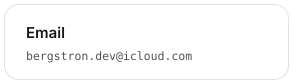</picture></a><a href="https://www.linkedin.com/in/eduardo-bergstron-986108143/"><picture><source media="(prefers-color-scheme: dark)" srcset="./cards/dark/en/link-linkedin.svg"/>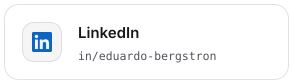</picture></a><a href="https://github.com/B3RG5TRON"><picture><source media="(prefers-color-scheme: dark)" srcset="./cards/dark/en/link-github.svg"/></picture></a>

<picture><source media="(prefers-color-scheme: dark)" srcset="./cards/dark/en/footer.svg"/></picture>
